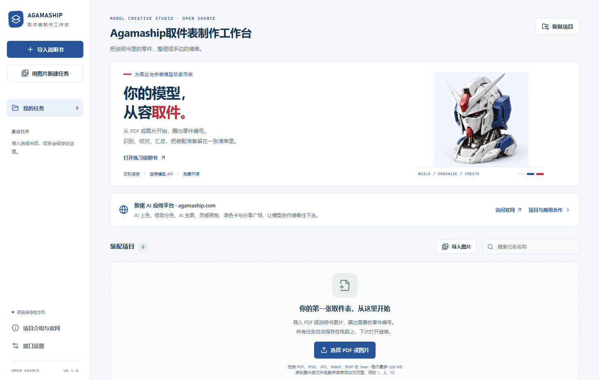
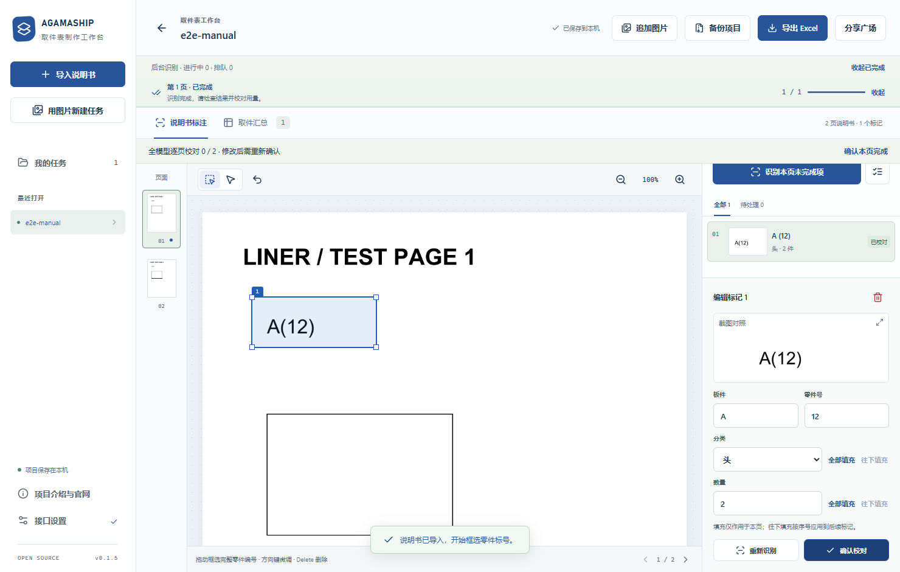

# Agamaship取件表制作工作台

[下载 Windows 桌面版（EXE）](https://github.com/EpsonMa1990/liner-parts/releases/latest/download/Agamaship-Desktop.exe) · [全部版本与便携 ZIP](https://github.com/EpsonMa1990/liner-parts/releases) · [网页版](https://agamaship.com) · [反馈问题](https://github.com/EpsonMa1990/liner-parts/issues)

面向高达与拼装模型玩家的本地桌面工具。导入 PDF 或说明书图片，框选零件标号，使用自己的 OpenAI 兼容视觉模型识别，对照截图校对后导出 Excel。任务、说明书和标注保存在本机，本地制作无需网站账号。可选的广场分享功能需要登录线上平台。





## 项目与官网

Agamaship取件表制作工作台是[胶佬 AI 应用平台](https://agamaship.com)的开源桌面取件工具。桌面版侧栏的「项目介绍与官网」提供功能介绍、源码地址和合作入口。

官网为模型玩家提供取件表制作、AI 上色、极致分色、AI 生图、灵感画板、品牌漆色卡与相近色查询，以及作品和取件表分享广场。[公开功能教程](https://agamaship.com/features/index.html)无需登录；在线工作区需登录，AI 生成按官网当前规则计费。

有定制工具、私有部署、功能集成、团队使用等商用需求，或模型品牌、工具厂家及机构的展示推广合作需求，欢迎[通过官网联系站长](https://agamaship.com/features/index.html#contact)洽谈。源码采用 MIT 协议，第三方组件遵循各自许可证，详见项目许可证文件。

GitHub 项目地址：<https://github.com/EpsonMa1990/liner-parts>。欢迎提交问题、建议和代码贡献。

## 普通用户使用

下载上方 `Agamaship-Desktop.exe`，双击即可打开 **Agamaship取件表制作工作台**，无需安装程序或管理员权限。首次启动需要解包内置组件，请稍候。支持 Windows 10/11 x64，无需安装 Python 或 Node.js；需要 Microsoft Edge WebView2 Runtime，缺少时可从 [Microsoft 官方下载页](https://developer.microsoft.com/microsoft-edge/webview2/)安装。

Release 同时提供便携 ZIP：解压整个目录后运行 `LinerParts.exe`，不要只复制其中的 exe。本机项目保存在独立的数据目录，删除 EXE 不会删除项目。软件免费开源；识别时使用你自己的模型 API，费用由服务商收取。

当前 EXE 未做代码签名，可用同一 Release 的 `SHA256SUMS.txt` 校验下载文件。

## 功能

- 汇总表与网页版一致：相同部件分类、相同板件合并为一行，每个零件号显示「× 数量」，另有合计数量与来源页码。可切换按板件汇总，跨分类累加同一编号的数量。Excel 包含「取件汇总」「按板件汇总」「识别明细」三个工作表。

- 本地任务列表、改名、删除、PDF / 图片分页预览与原创练习说明书。
- 直接选择一张或多张 PNG、JPG、JPEG、WebP、BMP 图片创建任务，也可向已有 PDF / 图片任务追加图片页。无需先转成 PDF；图片自动校正拍摄方向，透明区域使用白底，按 PNG 保存。
- 标记列表显示对应截图，编辑区提供高清截图对照与点击放大；移动、缩放选框后截图同步更新，尚未保存的标记也可预览。
- 创建、移动、调整、删除标记框；键盘微调；沿用网页版分类下拉选项与数量输入，分类和数量均支持「全部填充」「往下填充」。
- 每 10 个截图按标记序号从上到下拼成一张图，一次请求识别整张拼图；支持未完成项续识别、失败重试、取消、进度保存与重启恢复。
- 后台最多同时运行 2 个识别任务，更多任务自动排队。仅锁定已提交识别的页面，其他页面可以继续画框、校对、保存和提交，也可追加图片；队列按页显示进度并支持单独取消。
- Base URL / API Key / 视觉模型配置；读取模型列表；图片识别连接测试；可编辑预制提示词。
- Excel 取件汇总与逐框明细；完整 `.liner` 项目备份和导入。
- 整份模型逐页确认后，一键打包全部页面、区域截图、框坐标与识别结果，登录平台提交审核。审核通过后发布到取件表广场，奖励 5 张 AI 生成卡。

## 从源码运行（Windows / Python 3.11+ / Node.js 20.19+）

```powershell
python -m venv .venv
.\.venv\Scripts\python.exe -m pip install -e ".[dev]"
cd frontend
npm ci
npm run build
cd ..
.\.venv\Scripts\python.exe -m liner_parts
```

桌面界面使用 pywebview 和 Microsoft Edge WebView2 Runtime。若系统没有 WebView2，请从 Microsoft 官网安装。开发排查时可以用 `python -m liner_parts --browser` 打开相同的本地界面。

默认项目目录由 platformdirs 选择；Windows 通常是 `%LOCALAPPDATA%\LinerParts`。可通过 `--data-dir D:\MyParts` 指定独立目录。程序使用进程锁，防止多个窗口同时写入同一个数据目录。

## 配置与使用

1. 打开「接口设置」，填写服务商提供的 Base URL（如 `https://example.com/v1`）、自己的 API Key 和支持图片输入的模型名称。模型名不能仅凭文本聊天可用来判断。
2. 保存设置。可「读取模型列表」，列表仅代表接口返回的模型，不代表全部支持视觉；不支持列表接口时直接填模型名称。
3. 「测试图片识别」会向已配置的服务发送一张应用生成的测试图，可能产生少量模型费用。
4. 导入 PDF，或点击「用图片新建任务」选择图片。多张图片按文件名的数字顺序添加为页面，例如 1、2、10；每张图片对应一页，也可以通过工作台顶部「追加图片」逐张添加。选择页面，用鼠标框住一个完整的板件/零件标号。框内保留足够留白，不要截断小字。右侧列表和编辑区会显示截图，点击「截图对照」可以放大查看。
5. 设置分类与数量。每项旁的「全部填充」将当前值应用到本页全部标记；「往下填充」按标记序号应用到当前标记之后的所有标记，包括被「待处理」筛选隐藏的标记，不影响其他页。填充可撤销并自动保存。执行识别后检查「待复核」和「失败」项，并核对重复装配、左右对称、×2 等实际用量。模型只识别编号，不推测用量。
6. 导出 Excel。汇总只计入「已识别」「已校对」且板件、编号齐全的行；全部框及失败信息都保留在明细中。未处理的页不会自动检测出遗漏。

每份说明书最多 500 页，图片必须为静态图片，单张最多 4000 万像素；每次上传最多 128 MB，保存后的 PDF 与图片原稿总计最多 128 MB。PDF 和 `.liner` 文件每次选择一个，图片可多选。追加失败会回滚本批图片，已有页面和标记保留。

远程接口必须使用 HTTPS，本机模型服务允许 `http://127.0.0.1:端口/v1`。兼容范围是 `POST /chat/completions` + `image_url` Base64 图片输入，模型输出按固定 JSON 校验。仅支持 Responses API 的服务暂不支持。

默认不强制 `response_format`，适应更多兼容服务；支持 JSON 模式的服务可在高级设置中开启。固定每批最多 10 个截图，按页码和标记序号从上到下拼成一张 PNG，仅发送一个 `image_url`。例如 23 个待识别标记分成 10、10、3 个的三张拼图，最后一批不足 10 个也会提交。灰色栏的行序号与文字中的 `box_id` 一一对应，避免结果错位；只有结果数量和 ID 全部匹配才写入。大尺寸截图会按比例缩小以控制拼图大小，不拉伸；应尽量准确框选完整标号。旧版本批量设置自动迁移，已有项目和自定义提示词保留。

429 / 500 / 502 / 503 / 504 最多自动重试两次；请求超时不自动重试。重复请求可能产生额外费用。

识别使用两个后台工作线程，限制在整个应用内共享。第一页识别时，可以直接切到第二页画框并提交；两个任务并行处理，后续任务按提交顺序排队。每个任务仍按每批最多 10 个截图拼图识别。已提交页面在运行或排队期间暂时锁定，防止结果覆盖编辑；其他页可以自由编辑。「识别整份说明书的未完成项」会跳过已在队列中的页面。后台进度与页面结果一并刷新，已在其他页面输入或保存的修改不会被旧响应覆盖。

队列中的各项可以单独取消。取消等待中的任务会立即释放页面且不调用模型；取消正在运行的任务会停止后续批次，当前网络请求可能持续到超时。此前完成的批次保留；当前被取消批次不回填，也不影响其他识别任务。关闭应用后重新打开，未完成任务标记为已中断，可继续识别。

## 完整模型分享（v0.1.4）

1. 完成整个模型的取件表，核对所有装配步骤。每页填写分类、板件、零件号和数量，处理所有待识别、待复核和失败项，再点击「确认本页完成」。封面、目录等没有零件的页面需要填写无取件内容的原因。
2. 所有页面确认后，点击顶部「分享广场」。修改标记、数量或重新识别后，该页确认自动失效；新追加的图片页也需确认。只处理部分页面无法提交。程序检查已导入的页面，漏导说明书、漏框和实际重复装配用量仍需作者逐页核对。
3. 使用 agamaship.com 的账号密码登录，或填写平台签发的 JWT。新账号先在官网注册并设置密码。平台登录与模型 Base URL / API Key 相互独立。
4. 填写明确的模型名称（建议含品牌、比例、型号与版本），勾选已完成整个模型的声明，再点击「提交审核」。打包和上传在后台进行，可以返回工作台继续操作；请保持应用打开至提交结束。分享保存提交时的快照，后续本地修改不会改变已提交内容。
5. 在同一任务的分享窗口点击「刷新审核状态」。通过后可打开广场链接，**5 张 AI 生成卡自动发放给提交账号**，沿用平台现有使用卡有效期。退回时显示修改意见，修改、重新确认后可再次提交；同一账号原样重复提交会返回原记录，不重复发布或发卡。

分享包为明确白名单的 PNG 图片与 JSON 结果，最多 500 页、10000 个标记、每页 1000 个标记、单图 20 MB、包体及解压图片总量 128 MB。包括整页预览、每个框的高清截图、归一化坐标、分类、数量、板件、零件号，不含原始 PDF、接口设置、API Key、自定义提示词、密码、JWT 或本地路径。网页支持逐页框图对照、截图放大和取件表 CSV 下载。

广场分享取决于线上平台是否开放兼容接口，参见 [分享协议说明](docs/platform-sharing.md)。桌面端会先探测接口版本；平台尚未开放时会明确提示。本地制作、识别和导出不依赖分享服务。

## 数据与隐私

- PDF、图片、预览、裁图、标记框和识别结果在本机处理和保存。点击识别时，选中的局部截图、提示词及框 ID 发送到配置的模型服务；主动提交广场分享时，完整模型分享包发送到线上平台。查看本地截图不调用模型。
- 平台 JWT 仅保存在当前进程内存中，退出登录或关闭应用即清除；平台密码不持久保存。再次打开应用查看审核结果时需重新登录，提交编号保存在本机数据库。
- 软件免费开源；API 服务费用及数据处理政策由所选服务商决定。
- 密钥可保存到系统凭据管理器；不可用时仅保留到本次运行结束，绝不写入 JSON、SQLite、项目包或日志。切换接口地址不会把旧接口密钥发到新地址。
- `.liner` 是包含说明书原稿和 `manifest.json` 的 ZIP 文件，不包含接口设置或密钥；导入时创建独立任务。纯 PDF 项目继续使用 v1 格式；包含图片的项目使用 v2 格式，保存对应 PNG，需 v0.1.2 或更新版本打开。原有 PDF 项目和数据库自动兼容。
- 本地服务只监听 127.0.0.1，使用随机会话、来源校验和请求校验，不对局域网开放。

## 开发与验证

```powershell
.\.venv\Scripts\python.exe -m pytest
.\.venv\Scripts\python.exe -m ruff check src tests
cd frontend
npm run build
npx playwright install chromium
npm test
```

也可以设置环境变量 `LINER_TEST_BROWSER=msedge`，使用本机已安装的 Edge 运行界面测试。测试调用隔离的模拟模型接口，不发送实际付费请求。Windows 原生 WebView2 与关闭前保存测试：`python scripts/smoke-desktop.py`。

前端为独立 Vue 3 工作台，延续现有项目的百分比坐标框选、分类、数量和按板件汇总流程；后端为 Python + SQLite + PDFium。PDFium 调用全局串行化，模型请求在后台队列运行。Web 界面构建产物随 Python 包分发，不加载在线 CDN。

## Windows 打包

在项目根目录运行 `powershell -ExecutionPolicy Bypass -File scripts/build-windows.ps1`，生成单文件应用 `dist/Agamaship-Desktop.exe` 以及目录式便携版 `dist/LinerParts`。普通用户无需安装 Python 或 Node.js。首次发布建议在干净的 Windows 机器上验证 WebView2、中文路径、导入与导出。

构建面向 Windows 10/11，使用系统自带的 Universal CRT；打包时排除构建机器上的 `ucrtbase.dll`，不另行安装或替换系统运行库。

运行 `python scripts/package-release.py`，生成便携 ZIP、源码包及 `SHA256SUMS.txt`。发布文件不包含平台后端、部署配置或用户文件。仓库另保留 Inno Setup 脚本供自行制作安装器；v0.1.5 官方发布使用单文件 EXE 与便携 ZIP。

请保留整个 `LinerParts` 文件夹，不要只复制 exe。可运行 `LinerParts.exe --self-check report.json` 做离线桌面自检；报告包括 WebView2、Python 桥接、关闭前保存、图片页导入与追加、图片项目恢复、截图预览、双线程识别及完整模型分享。自检使用临时目录、原创示例和模拟平台，不读取用户项目、不调用外部模型或实际发布作品。

`requirements-windows.lock` 记录此次 Windows 构建的 Python 依赖版本；前端版本由 `frontend/package-lock.json` 固定。源码开发使用 `pyproject.toml`，复现同一 Windows 环境时先安装 lock 文件，再执行 `pip install --no-deps -e .`。

## 开源

项目代码采用 MIT License，见 [LICENSE](LICENSE)。第三方组件保留各自许可证，见 [THIRD_PARTY_NOTICES.md](THIRD_PARTY_NOTICES.md)。不附带商业说明书、任何服务端凭据或用户数据。欢迎提交问题、兼容性样本及改进；请在分享项目包前确认其中的说明书适合公开。
